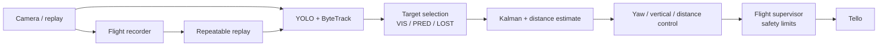

# AVIS

> Visual follow-me control for a Ryze Tello: detect a chosen object, keep it in frame, and turn that estimate into safety-limited motion commands.

AVIS is a Python prototype for autonomous visual following. It combines YOLO detections, ByteTrack identities, Kalman prediction, independent yaw/vertical/distance controllers, and a flight supervisor that has the final say before any command reaches the drone.


## What it does

- Detects objects with Ultralytics YOLO — one chosen COCO class or all of them — and keeps an identity with ByteTrack.
- Lets the operator choose the target with a click. The Kalman filter was added for Wi-Fi latency — every decision is made on an image that is already old, so the system tracks the target's velocity instead of its last known box. The same estimate holds the target when it briefly disappears.
- Steers yaw, vertical position, and distance independently. Forward motion is reduced until the drone faces the target.
- Separates the controller's *desired* command from the command the flight supervisor actually allows.
- Records the raw video, detections, timing, and baseline commands, then replays the same flight for repeatable tuning.

## Demo

These frames are from real indoor Tello runs. The red box is the selected target, the yellow reticle is the Kalman hypothesis during an occlusion, and the banner shows an actual command from the recording.

| Predict through occlusion | Correct yaw | Adjust distance |
| --- | --- | --- |
|  |  |  |

## Architecture



The detailed component map, data flow, and design decisions are in [the architecture guide](docs/architecture.md).

## Quick start

**Prerequisites:** Python 3.12, a webcam for local testing, or a Ryze Tello connected to the host computer's Wi-Fi. Use an isolated, obstacle-free area for all flight tests.

```bash
git clone https://github.com/kyryloharbuz/avis.git
cd avis
python3.12 -m venv .venv
source .venv/bin/activate
pip install -r requirements.txt
```

Start with the webcam-only mode:

```bash
python main.py --person
```

Then progress through the Tello modes deliberately:

```bash
python main.py --tello                 # video stream only; no flight commands
python main.py --tello --fly --person  # flight control, forward motion enabled
```

Click the desired detection in the video window. In flight mode, press `T` to take off, wait for the hover state, then press `G` to arm/disarm autonomous tracking. Press `L` to land; `X` is the emergency-stop command. `Esc` or `Q` ends the application and triggers the normal shutdown path.

> **Safety note:** this is an experimental controller for a real aircraft. Keep a clear landing area, maintain visual line of sight, start with forward motion disabled (`--no-forward`), and be ready to land manually. The software is not a substitute for responsible operation or local flight rules.

## Replay a recorded flight

Each live run records a video and a JSONL log into `recordings/` (ignored by Git because recordings are large and may contain private footage). Replay uses the recorded detections and timing, so it avoids running YOLO and makes control tuning repeatable:

```bash
python main.py --replay flight_20261004_182119
python main.py --replay flight_20261004_182119 --headless
```

The second command is useful for fast, non-interactive runs. Replay is an analysis tool, not a physics simulator: it recomputes the command profile against fixed video and cannot show how a different command would have changed the real drone trajectory.

## Test

Two regression suites, both plain assertions with no test framework. The first covers value objects, tracking behaviour, safety states, replay and integration paths; the second covers the control axes and replays real recordings to check that the commands are strong enough to move the aircraft:

```bash
.venv/bin/python tests/test_all.py      # 138 checks
.venv/bin/python tests/test_follow.py   # 117 checks, replays recordings if present
```

## Project layout

```text
avis/
  perception/    # frame sources, YOLO/ByteTrack, target selection, Kalman filter
  control/       # PID axes, flight state machine, drone adapters
  view/          # OpenCV rendering and keyboard input
  replay.py      # recording format and replay source
docs/
  architecture.md
  usage.md
tests/           # test_all.py, test_follow.py
main.py          # composition root and command-line flags
score.py         # scores recorded flights from their JSONL logs
tello_check.py   # pre-flight diagnostics; never commands takeoff
tello_fly.py     # manual keyboard control, no autonomy
```

## Documentation

- [Architecture and design rationale](docs/architecture.md)
- [Operating guide and command reference](docs/usage.md)

## Current scope

AVIS is an experimental project, tested with indoor recordings and a Tello. Its replay mode is intentionally a controlled input harness rather than a full flight simulator. Large recordings, model weights, calibration data, and local run artifacts stay out of the repository by design.
