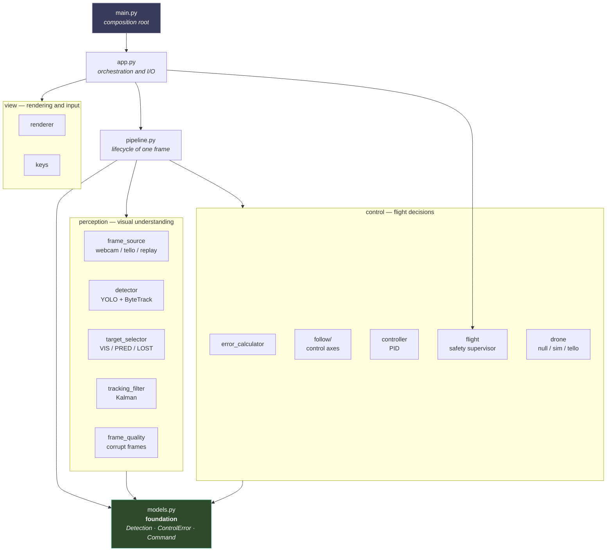
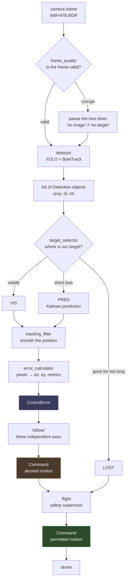

# AVIS Architecture

## Layers

Dependencies point **downward only**, and there are no import cycles.



**Why `models.py` is at the bottom.** It imports none of the project's code —
only `dataclass`. Every other layer can therefore import it without creating an
import cycle. In Python, a cycle is especially painful: a module *executes*
during import, and another module can observe it in a half-built state.

## A frame's lifecycle

This is what a single console log line describes:

```
[VIS ] ex=    -68 ey=     -0 d=1.34m    |   yaw= -22.9 vert=  +0.0 fwd= +11.9   -> MOTORS yaw= -5.4 vert= +0.0 fwd=+20.0
```



**The key boundary is between `Command` and `Command`.** The type is the same,
but the meaning differs: the controller states what it *wants* and the
supervisor determines how much is *allowed*. That is why the log shows two
values together: `fwd= +11.9` against `MOTORS fwd=+20.0` — here the supervisor
raised the command, because anything below the sensitivity floor of 20 would
not move the aircraft at all.

**Independent axes, coupled behaviour.** Yaw, altitude, and distance each have
their own controller because they use different units and different
measurements: horizontal error is in pixels, distance is in metres, and
vertical control is disabled by default while the Tello maintains height.
Coupling exists only where physics requires it: a rapidly changing distance
temporarily freezes the vertical axis because approaching a target moves its box
centre downward; `AlignmentGate` gradually reduces forward motion until the
drone faces the target. The system therefore does not wait for a rigid sequence
of “turn, then fly,” but it also does not fly at full speed past a target that
is still to the side.

## Three systems of units

Mixing these units caused real bugs, so every configuration field carries its
unit in its **name**.

| Unit | Example | Why |
|---|---|---|
| pixels | `yaw_deadzone_px = 24` | describes detector-box jitter |
| fraction of frame | `align_full = 0.35`, `frame_fill_stop = 0.50` | independent of resolution |
| metres | `distance_target_m = 1.70` | physical quantity with a linear response |

For example, an object one quarter of a frame's half-width from the centre has
an error of about 81 px in a 648 px frame, but 160 px in a 1280 px frame. A
pixel gate with a threshold of 100 px would permit forward motion in the first
case and prohibit it in the second, despite identical scene geometry.
`AlignmentGate` therefore receives the normalized `norm_x` error: it is the
same in both frames, and its decision does not depend on resolution.

## Module responsibilities

| Module | Responsible for | Deliberately not responsible for |
|---|---|---|
| `models.py` | the system's shared vocabulary | behaviour of the system |
| `pipeline.py` | computation: frame → command | I/O, windows, keyboard input |
| `app.py` | loop, I/O, orchestration | tracking internals |
| `target_selector.py` | VIS / PRED / LOST | drone motion |
| `follow/` | desired motion | what is safe |
| `flight.py` | what is safe | where to fly |
| `main.py` | composing concrete implementations | application logic |

## Where abstractions exist — and where they do not

An interface (ABC) exists **only when there are at least two implementations**:

| Interface | Implementations |
|---|---|
| `FrameSource` | `WebcamSource`, `TelloSource`, `ReplaySource` |
| `Drone` | `NullDrone`, `SimDrone`, `TelloDrone` |
| `Renderer` | `CvRenderer`, `HeadlessRenderer` |

The rest are ordinary classes. An interface for a single implementation would
be ceremony for its own sake: it solves nothing and adds another file to read.

`ReplaySource` reads not only the video, but also the recorded `dt`, detections,
and selected `target_id` for every frame. On replay, YOLO does not run;
Kalman/PID see the same inputs and the same timing as in the original flight.
You can change one coefficient and fairly compare the command profile without a
new flight. The limitation is fundamental: the video is fixed. New commands do
not change the next frame, so replay shows changed controller decisions, not a
new drone trajectory.
